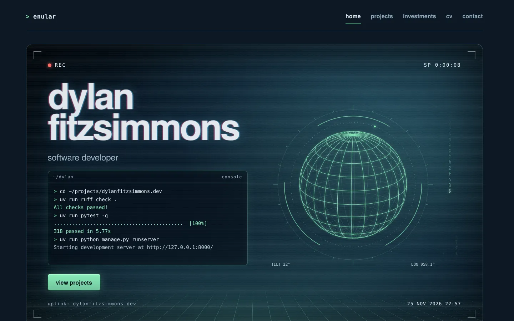
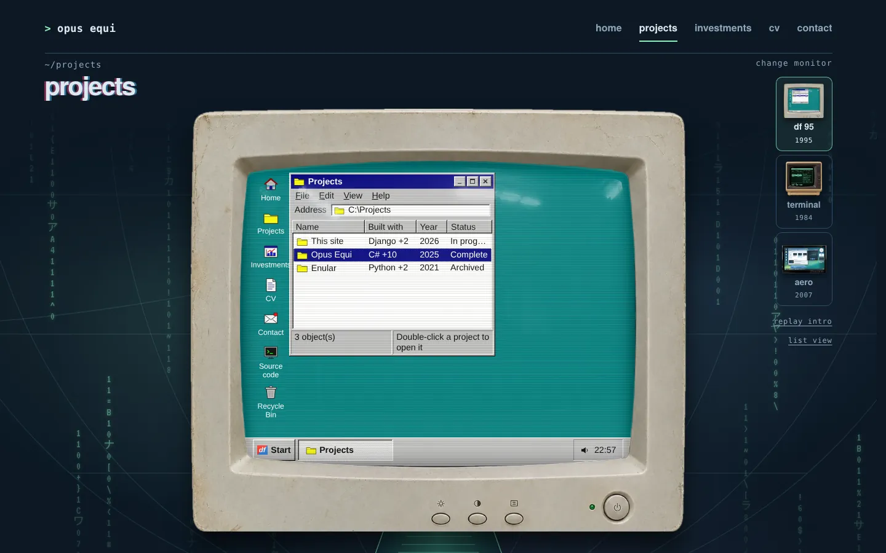
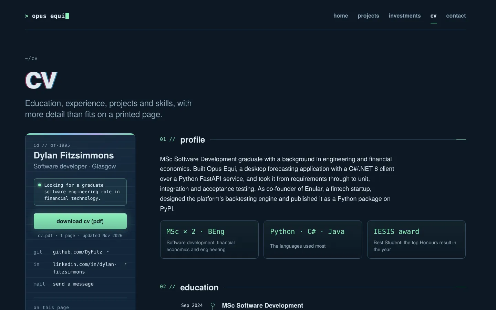
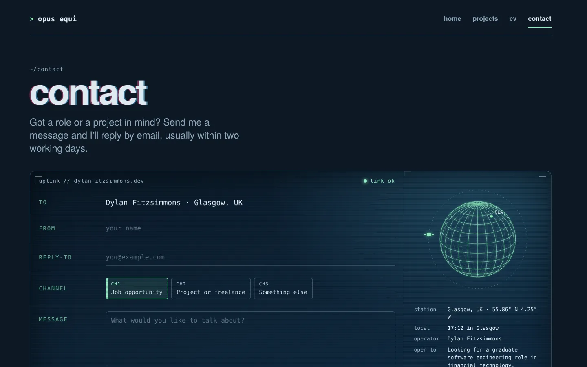
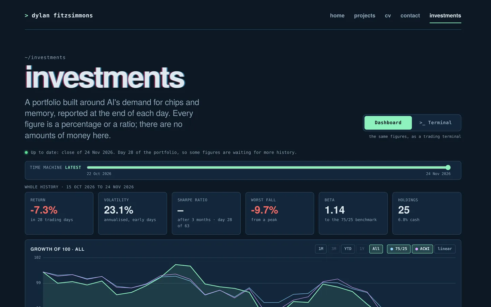
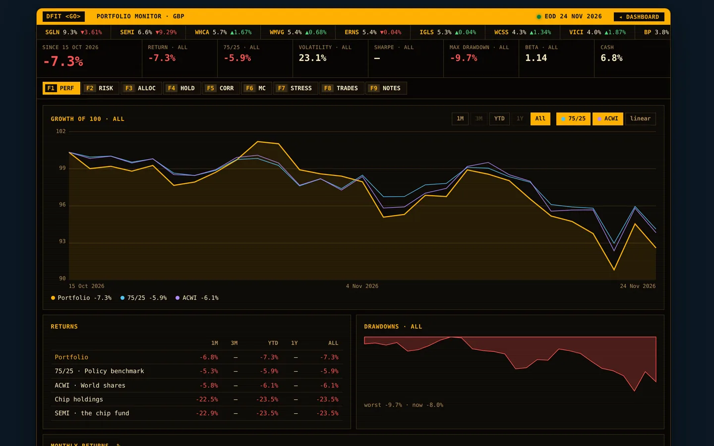

# dylanfitzsimmons.dev

[](https://github.com/DyFitz/dylanfitzsimmons.dev/actions/workflows/ci.yml)

Source code for [dylanfitzsimmons.dev](https://dylanfitzsimmons.dev), the personal site of Dylan Fitzsimmons: software projects, a CV, a contact form and an investment portfolio reported each trading day, built with Django.

| | |
| --- | --- |
|  |  |
| **Home:** a console and a wireframe globe, drawn on canvas | **Projects:** three monitors from 1984, 1995 and 2007, each with its own working interface |
|  |  |
| **CV:** built from the database, with a one-page PDF to download | **Contact:** messages saved, emailed on and screened for spam |
|  |  |
| **Investments:** returns, risk and allocation against three benchmarks, updated each weekday | **Investments, as a terminal:** the same figures, keyboard-driven, with function-key views |

## Highlights

- **Server-rendered pages that work without JavaScript.** Scripts only add to them, as ES modules with no build step.
- **A still version of every animation.** It is what the server sends, it is used when reduced motion is set, and the site switches to it by itself on devices that can't keep the animations smooth.
- **A strict Content Security Policy.** There are no inline scripts or styles anywhere, and the tests check for them.
- **Content edited in the Django admin.** Projects, the CV and the portfolio's thesis live in the database; data migrations supply the initial text and leave admin edits alone.
- **A portfolio reported without a single amount of money.** A Render cron job collects the account's Flex report from Interactive Brokers' web service each weekday, reduces it to weights and time-weighted returns, and stores nothing else. Failures and an expiring API token are emailed.
- **The same analytics on both sides.** Sharpe ratios, drawdowns, risk contributions, a Monte Carlo projection and stress tests are computed in Python on the server and mirrored in JavaScript for the interactive views, agreeing to within floating-point rounding.
- **A contact form without a CAPTCHA.** Spam is stopped by a honeypot field, a signed timing check and a rate limit, and old messages are deleted after 12 months.
- **Configured entirely from the environment.** The production settings refuse to start if anything required is missing.
- **284 tests at 97% coverage**, with Ruff, migration checks, Django's deployment checks, a PostgreSQL test run and a Docker build on every push.

## Stack

Python 3.14 · Django 6.1 · PostgreSQL · plain JavaScript and CSS · pytest · Ruff · uv · Docker · Gunicorn · WhiteNoise · GitHub Actions · Render (web service and cron job) · Interactive Brokers Flex Web Service

## Running locally

With [uv](https://docs.astral.sh/uv/getting-started/installation/) and git installed:

```bash
uv sync
cp .env.example .env       # in PowerShell: Copy-Item .env.example .env
uv run python manage.py migrate
uv run python manage.py runserver
```

The site is then at <http://localhost:8000>. Local development uses SQLite, so no database server is needed.

## Documentation

- [Development](docs/development.md): everyday commands, project structure and how the front end fits together
- [Configuration](docs/configuration.md): every environment variable the site reads
- [Deployment](docs/deployment.md): running the production image and the daily investments update
- [Architecture decision records](docs/adr): the reasoning behind the main design choices

## Still to come

- Two-factor login for the admin
- Error tracking
